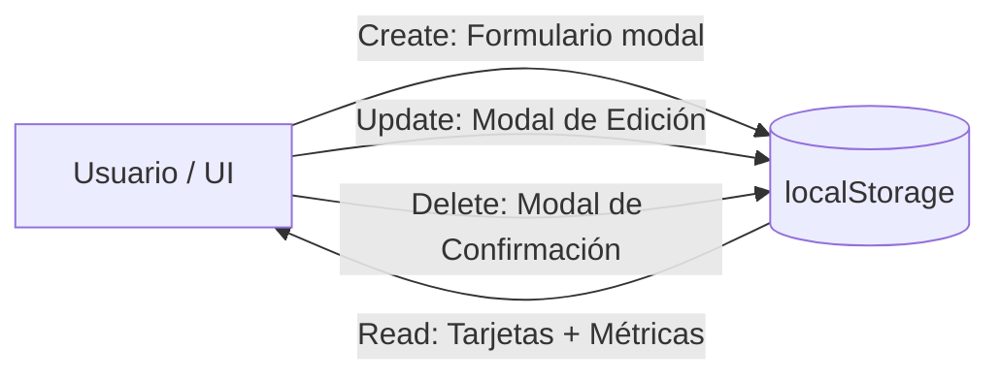

# 🚀 AgileFlow - Gestor de Tareas y Sprints Ágiles

> **Trabajo Práctico:** Aplicación web CRUD desarrollada con Inteligencia Artificial  
> **Seminario:** Gestión de Software Ágil asistido por Inteligencia Artificial  
> **Autor / Estudiante:** Santiago Gonzalez Reinoso 
> **Enlaces de Entrega:**
> - 🎥 **Video Explicativo:** https://youtu.be/FRw9a-cDBhk 
---

## 📌 Descripción del Proyecto

**AgileFlow** es una aplicación web responsiva e interactiva diseñada para la gestión ágil de historias de usuario y tareas de sprint (*Product Backlog*). La aplicación permite realizar de forma completa e intuitiva el ciclo de operaciones **CRUD** (*Create, Read, Update, Delete*), incorporando estimaciones en puntos de historia (secuencia Fibonacci), asignación de responsables, niveles de prioridad y estados ágiles en tiempo real.

El proyecto fue concebido, programado y refactorizado de forma iterativa mediante **ingeniería de prompts con Inteligencia Artificial**, demostrando el uso ético y responsable de la IA como copiloto de desarrollo de software ágil.

---

## 🛠️ Tecnologías Utilizadas

La aplicación fue desarrollada con una arquitectura desacoplada de dependencias pesadas para garantizar máxima portabilidad, velocidad de carga y facilidad de ejecución:

| Componente | Tecnología | Justificación Técnica |
| :--- | :--- | :--- |
| **Estructura** | HTML5 Semántico | Marcado limpio, accesible y estructurado para facilitar la lectura por pantalla y el SEO. |
| **Estilos & UI** | Tailwind CSS (CDN) + CSS3 | Diseño moderno tipo *Dark Mode*, responsivo, con microinteracciones y efectos de desenfoque (*backdrop-blur*). |
| **Iconografía** | FontAwesome 6 | Iconos vectoriales claros para mejorar la experiencia de usuario (UX). |
| **Lógica** | JavaScript Moderno (ES6+) | Programación modular, manipulación eficiente del DOM y separación de responsabilidades. |
| **Persistencia** | Web Storage API (`localStorage`) | Almacenamiento local en el navegador sin necesidad de desplegar servidores complejos, garantizando que los datos no se pierdan al recargar. |

---

## ⚡ Instrucciones de Ejecución

Para ejecutar el proyecto **no se requiere instalar Node.js ni bases de datos externas**.

### Opción 1: Ejecución Directa (Recomendada)
1. Descarga o clona el repositorio:
   ```bash
   https://github.com/12038232/agileflow-crud-ia.git
   ```
2. Dirígete a la carpeta del proyecto.
3. Haz doble clic sobre el archivo `index.html` para abrirlo en cualquier navegador web moderno (Google Chrome, Microsoft Edge, Firefox, Brave, Safari).
---
## 🔄 Explicación de las Operaciones CRUD

La aplicación implementa fielmente las cuatro operaciones fundamentales:



### 1. Create (Crear)
- **Función:** `createTask(taskData)`
- **Flujo:** Al pulsar el botón *"Nueva Tarea"*, se despliega un modal con validaciones de campos requeridos (título obligatorio con longitud mínima, responsable, puntos de historia, estado y prioridad). Al enviar el formulario, se genera un ID único timestamp (`task-Date.now()`), se añade al estado en memoria, se sincroniza con `localStorage` y se emite una notificación *toast* de éxito.

### 2. Read (Leer / Consultar)
- **Funciones:** `getFilteredTasks()`, `renderCards()`, `renderMetrics()`
- **Flujo:** Al cargar la app, se leen los datos desde `localStorage` (o se inyectan datos de demostración si es la primera vez). Los datos se renderizan en una cuadrícula interactiva. Cuenta con:
  - **Buscador en tiempo real:** filtra por coincidencias en título, descripción o responsable.
  - **Filtros por Estado y Prioridad:** permiten segmentar el tablero ágil.
  - **Tablero de Métricas:** total de tareas, en progreso, completadas y suma total de puntos de historia.

### 3. Update (Actualizar / Editar)
- **Funciones:** `handleOpenEditModal(id)`, `updateTask(id, updatedFields)`
- **Flujo:** Cada tarjeta cuenta con un botón de edición. Al hacer clic, se recupera el objeto por su ID y se autocompletan los campos del modal. Al guardar cambios, se actualiza el objeto en el arreglo, se registra la fecha de modificación (`updatedAt`), se guarda en `localStorage` y la vista se refresca instantáneamente.

### 4. Delete (Eliminar)
- **Funciones:** `handleOpenDeleteModal(id)`, `deleteTask(id)`
- **Flujo:** Al hacer clic en el icono de papelera, se abre un modal de confirmación para evitar borrados accidentales. Si el usuario confirma, el registro es filtrado y removido permanentemente de `localStorage`, recalculando las métricas en tiempo real.

---

## 🤖 Bitácora de Prompts de Inteligencia Artificial

Siguiendo la metodología de desarrollo asistido por IA, el código fue construido de forma incremental a través de 5 prompts guiados y refinados con criterio técnico:

### 🔹 Prompt 1: Arquitectura y Estructura Semántica (HTML)
* **Texto del Prompt:**
  > *"Actúa como un arquitecto frontend senior. Necesito crear una aplicación web para la gestión ágil de tareas (Scrum/Kanban) que funcione como un CRUD completo. Proporcióname la estructura HTML5 semántica que incluya: encabezado con botones de acción rápida, un panel de métricas ágiles (tareas totales, en progreso, completadas, puntos de historia), una barra de búsqueda con filtros por estado y prioridad, un contenedor para las tarjetas de tareas y modales accesibles para crear/editar y confirmar eliminación. Utiliza Tailwind CSS vía CDN para mantenerlo ligero."*
* **Propósito y Justificación:** Establecer un layout profesional y responsive desde el inicio, asegurando accesibilidad y una estructura adecuada para las operaciones CRUD sin requerir frameworks pesados.

### 🔹 Prompt 2: Sistema Visual y Microinteracciones (CSS)
* **Texto del Prompt:**
  > *"Genera una hoja de estilos `style.css` complementaria a Tailwind para darle un aspecto visual 'Dark Mode' refinado a la aplicación AgileFlow. Debe incluir: badges personalizados con transparencias y bordes sutiles según la prioridad (Baja, Media, Alta, Crítica) y el estado, animaciones suaves de entrada y salida para los modales, efecto elevador en hover para las tarjetas y estilos animados para alertas flotantes (toast notifications)."*
* **Propósito y Justificación:** Añadir valor estético y diferenciador al proyecto, mejorando la retroalimentación visual al usuario durante las acciones del CRUD.

### 🔹 Prompt 3: Lógica CRUD y Persistencia (JavaScript)
* **Texto del Prompt:**
  > *"Escribe un archivo `app.js` en Vanilla JavaScript moderno (ES6+) que implemente las cuatro operaciones CRUD (Create, Read, Update, Delete) sobre un listado de tareas ágiles. Debe utilizar la Web Storage API (`localStorage`) para persistir los datos de forma que no se pierdan al recargar. Incluye un arreglo de tareas de ejemplo iniciales (seed data) para cuando la base de datos esté vacía."*
* **Propósito y Justificación:** Implementar la lógica del negocio de manera desacoplada y limpia, con manejo adecuado de estados y persistencia local sin servidores.

### 🔹 Prompt 4: Refactorización, Filtros y Seguridad
* **Texto del Prompt:**
  > *"Revisa y refactoriza el código de `app.js`. Necesito que agregues: 1) Búsqueda en tiempo real que filtre simultáneamente por título, descripción y responsable; 2) Validación de formulario para evitar tareas vacías; 3) Sanitización básica de cadenas para evitar inyecciones de código (XSS) al renderizar contenido dinámico; 4) Recálculo dinámico del panel de métricas en cada operación."*
* **Propósito y Justificación:** Demostrar criterio técnico y calidad de software aplicando validaciones, filtros reactivos y prevención de vulnerabilidades web (XSS).

### 🔹 Prompt 5: Notificaciones Toast y Manejo de Errores
* **Texto del Prompt:**
  > *"Añade una función utilitaria de Toast Notifications en JavaScript nativo que informe al usuario con mensajes visuales temporales cuando una tarea se cree, actualice, elimine o si ocurre un error, reemplazando los `alert()` tradicionales del navegador por una experiencia de usuario moderna."*
* **Propósito y Justificación:** Reemplazar alertas invasivas del navegador por un sistema de retroalimentación profesional y no bloqueante.

---

## 📷 Capturas de Pantalla

*(Inserta aquí las capturas de pantalla de tu aplicación en funcionamiento antes de la entrega final)*

| Vista Principal y Métricas | Modal de Creación / Edición |
| :---: | :---: |
|  |  |

| Filtrado y Búsqueda en Tiempo Real | Notificaciones Toast y Confirmación |
| :---: | :---: |
|  |  |

---

## 🛡️ Ética y Uso Responsable de la IA

En cumplimiento con los lineamientos del seminario:
1. **Comprensión Total del Código:** Cada función, selector del DOM y evento presente en el código fuente es plenamente comprendido por el autor y puede ser explicado en detalle sin depender de la IA.
2. **Criterio Técnico y Personalización:** La IA funcionó como un acelerador de código base; la arquitectura de componentes, las decisiones de UX, las paletas de color, la estructura de datos ágiles (puntos Fibonacci, estados Scrum) y la lógica de negocio fueron definidas y adaptadas con criterio humano.
3. **Seguridad y Calidad:** Se exigió a la IA implementar sanitización de cadenas (`escapeHTML`) y validaciones defensivas de datos, aspectos que a menudo son omitidos en generaciones de código automáticas.

---

## 📂 Estructura del Repositorio

```text
agile-task-crud-ia/
│
├── index.html        # Estructura semántica, vistas y modales
├── style.css         # Estilos visuales, badges y animaciones
├── app.js            # Lógica CRUD, persistencia y control del DOM
├── README.md         # Documentación completa y bitácora de prompts
└── GUIA_VIDEO.md     # Guion detallado para la grabación del video de 10 min
```
